# Jalal Zerroudi

### Doctorant en IA · IoT & WMSN · Reinforcement Learning

📍 Fès, Maroc

---

## 🧭 Navigation

[Profil](#-profil) · [Projet de recherche](#-projet-de-recherche) · [Dépôts sélectionnés](#️-dépôts-sélectionnés) · [Expérience](#-expérience) · [Formation](#-formation) · [Compétences](#-compétences) · [Activités et langues](#-activités-et-langues) · [Activité GitHub](#-activité-github)

## 👋 Profil

**Doctorant en Intelligence Artificielle**, spécialisé dans l’**Internet des objets (IoT)** et les **réseaux de capteurs multimédias sans fil (WMSN)**. Titulaire d’un Master **Big Data & Systèmes Intelligents (BDSI)** de la Faculté des Sciences Dhar El Mehraz (FSDM), Université Sidi Mohamed Ben Abdellah (USMBA), Fès.

Mes travaux portent sur l’optimisation des réseaux de capteurs par **apprentissage par renforcement**, en mêlant simulation (**NS-3 / NS3-AI**), IA embarquée et systèmes de données reproductibles. Je conçois des solutions mesurables, orientées délai, énergie et qualité de service.

**Axes de recherche :** IA pour l’IoT · WMSN · Apprentissage par renforcement · Transmission multimédia économe en énergie

## 🔬 Projet de recherche

### Optimisation du transfert multimédia dans les réseaux de capteurs par apprentissage par renforcement
*Projet de fin d’études · février – juillet 2026*

- Modélisation d’un système dynamique de réseau de capteurs avec **NS-3 / NS3-AI**.
- Conception et expérimentation d’une stratégie de **Q-learning**.
- Évaluation selon le délai, la consommation énergétique, le taux de livraison des paquets (PDR), le PSNR et le SSIM.
- Résultats expérimentaux rapportés : réduction du délai de **86 %** et de la consommation énergétique de **69 %**, avec un **PDR de 100 %**.
- Développement d’un tableau de bord **Flask** et d’un environnement reproductible avec **Docker**.

## 🗂️ Dépôts sélectionnés

| Dépôt | Contenu |
|---|---|
| [`rag-context-citations`](https://github.com/Jalal-Zerroudi/rag-context-citations) | Indexation locale de documents TXT/PDF, recherche FAISS et réponses avec citations strictes des sources. |
| [`DocMorph`](https://github.com/Jalal-Zerroudi/DocMorph) | Service de conversion documentaire fondé sur Docling, utilisable en API ou en ligne de commande. |
| [`Wpf_App_Computer_Vision`](https://github.com/Jalal-Zerroudi/Wpf_App_Computer_Vision) | Application Windows en C#/.NET 8 pour expérimenter des opérations de traitement d’images. |
| [`MM-CTR-WWW-2025`](https://github.com/Jalal-Zerroudi/MM-CTR-WWW-2025) | Pipeline multimodal de recommandation combinant séquences Word2Vec, embeddings CLIP, distillation et fusion adaptative. |

## 💼 Expérience

### Stagiaire Data Engineering & Business Intelligence — WIT’INNOV
*Juillet 2026 – présent*

- Conception et automatisation de pipelines ELT pour intégrer, transformer et fiabiliser des données métier.
- Orchestration de workflows avec **Apache Airflow** et **dbt**.
- Modélisation et contrôle qualité des données pour l’analyse et le reporting.
- Création de mesures analytiques et de tableaux de bord avec **Power BI**.

### Stagiaire IA — Acacia Intelligent
*Janvier – juillet 2026 · Agent NL2GraphQL pour Sage X3 V12*

- Développement en Python d’un agent utilisant **RAG et des LLM** pour convertir des requêtes en langage naturel en requêtes GraphQL.
- Conception d’une architecture combinant routage déterministe, récupération de contexte et orchestration par LLM.
- Automatisation de l’extraction et de l’exploitation de données issues de Sage X3 V12.
- Développement d’une API **Flask** et d’une interface en ligne de commande, avec tests et optimisation du pipeline.

### Stagiaire Data Engineering & IA — DIGITAL VALLEY, Fès
*Juillet – septembre 2025*

- Développement d’un pipeline ETL multi-sources pour des données Web, CSV et Excel.
- Traitement de documents PDF et JPG avec des données textuelles et visuelles.
- Extraction automatique de champs à l’aide de l’OCR et de modèles de langage.
- Création d’un tableau de bord Power BI avec indicateurs, filtres dynamiques et actualisation automatisée.

## 🎓 Formation

- **Doctorat en Intelligence Artificielle : IoT & WMSN** · 2026–présent
- **Master Big Data & Systèmes Intelligents (BDSI)**, FSDM – Université Sidi Mohamed Ben Abdellah, Fès · 2024–2026 · *Diplômé*
- **Licence Sciences Mathématiques et Informatique**, FSDM – Université Sidi Mohamed Ben Abdellah, Fès · 2023–2024
- **DEUG Sciences Mathématiques et Informatique**, FSDM – Université Sidi Mohamed Ben Abdellah, Fès · 2021–2023
- **Baccalauréat Sciences Mathématiques A**, Lycée Lalla Amina, Meknès · 2021

## 🧰 Compétences

| Domaine | Outils et méthodes |
|---|---|
| **Machine Learning** | scikit-learn, XGBoost, Random Forest, SVM, clustering |
| **Deep Learning** | PyTorch, CNN, LSTM, Transformers |
| **Apprentissage séquentiel** | apprentissage par renforcement, Q-learning |
| **NLP** | Hugging Face, BERT, embeddings, LLM, RAG |
| **Vision par ordinateur** | YOLOv8, OpenCV, traitement d’images |
| **Données et programmation** | Python, Pandas, NumPy, Jupyter, SQL |
| **Data Engineering** | ETL/ELT, Apache Airflow, dbt, Spark |
| **Bases de données** | PostgreSQL, MongoDB, entrepôts de données |
| **Développement et MLOps** | Docker, Git, MLflow, Flask, Streamlit |

## 🌍 Activités et langues

- Participation au **Festival des Sciences Fès–Meknès**, Lycée Moulay Idriss, Fès · avril 2025
- **IoT Leader**, FSDM IT CLUB : participation et encadrement d’activités liées à l’Internet des objets durant le Master

**Arabe** (natif) · **Français** (courant) · **Anglais** (intermédiaire : documentation technique et scientifique)

## 📈 Activité GitHub

L’animation est générée par le workflow `snake.yml` selon trois déclencheurs : planification quotidienne à **00:00 UTC**, lancement manuel depuis l’onglet Actions, et chaque mise à jour de `main`. Les exécutions concurrentes sont annulées pour éviter des publications simultanées sur la branche `output`. La génération ne dépend d’aucun fichier de la branche principale : le workflow crée directement `dist/snake.svg`, puis publie uniquement ce répertoire sur `output`.

---

*Merci de consulter mon profil.*

